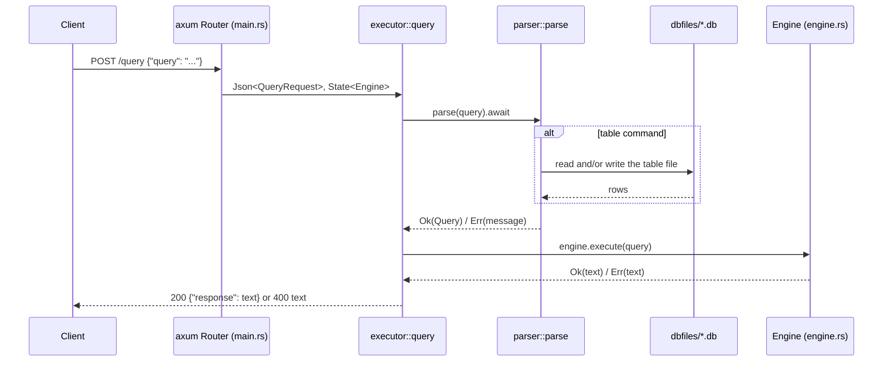

# Architecture

This page explains how DrastDB works inside: the modules, how a request travels through them, how data is stored, and where the design's limits are.

- [Overview](#overview)
- [Modules](#modules)
- [Request lifecycle](#request-lifecycle)
- [The Query type](#the-query-type)
- [Parsing](#parsing)
- [Table storage](#table-storage)
- [Key/value store](#keyvalue-store)
- [Concurrency](#concurrency)
- [Design notes](#design-notes)
- [Limitations and ideas for improvement](#limitations-and-ideas-for-improvement)

---

## Overview

DrastDB is a single binary that runs an HTTP server ([axum](https://github.com/tokio-rs/axum) on the [tokio](https://tokio.rs) runtime). It keeps two independent kinds of data:

| | Tables | Key/value store |
|---|---|---|
| Commands | `CREATE`, `DROP`, `INSERT`, `SELECT`, `UPDATE`, `DELETE FROM` | `SET`, `GET`, `DELETE` |
| Lives in | `./dbfiles/<table>.db` on disk | A `HashMap` in memory |
| Survives restart | ✅ Yes | ❌ No |
| Implemented in | `parser.rs` | `engine.rs` |

---

## Modules

```
src/
├── main.rs       entry point
├── executor.rs   POST /query handler
├── parser.rs     tokenizer + parser + table storage
├── engine.rs     key/value store + response formatting
├── handlers.rs   GET / handler
└── helpers.rs    startup banner
```

### `main.rs`

- Prints the startup message (`helpers::start()`).
- Reads the listen address from `DRAST_ADDR`, falling back to `127.0.0.1:3495`.
- Builds the axum `Router` with two routes, `GET /` → `handlers::root` and `POST /query` → `executor::query`, and attaches a shared `Engine` as router state.
- Binds a `tokio::net::TcpListener` and serves.

### `executor.rs`

The `POST /query` handler. It:

1. Deserializes the body into `QueryRequest { query: String }`.
2. Calls `parser::parse(&query).await`. A parse error becomes `400` + message.
3. Calls `engine.execute(query)`. `Ok(text)` becomes `200 {"response": text}` and `Err(text)` becomes `400` + text.

### `parser.rs`

The biggest module. It contains:

- **`Query`**: the enum describing a parsed query (see [below](#the-query-type)).
- **`tokenize`**: splits the input into tokens.
- **`Parser`**: a small cursor over tokens with helpers (`next`, `peek_is`, `expect`, `end`, `table_name`, `list`, `where_clause`).
- **Table storage helpers**: `load_table`, `save_table`, `table_path`, `column_index`, `row_matches`, `resolve_where`.
- **`parse`**: the entry point. It looks at the first word and dispatches to the right command.

### `engine.rs`

- **`Engine`**: holds the key/value store as `Arc<RwLock<HashMap<String, String>>>`. It derives `Clone`, and cloning shares the same map. axum clones the state for each request, so every request sees the same store.
- **`Engine::execute`**: runs `SET`/`GET`/`DELETE` against the map and turns table results into response text, including the tab-separated `SELECT` output.

### `handlers.rs`

`root` serves the `GET /` banner. The file also contains `query` and `memory` handlers and their request/response structs. These are earlier stubs that aren't attached to any route, which is why `cargo build` reports them as unused.

### `helpers.rs`

`start()` prints `DrastDB is running...`.

---

## Request lifecycle



As an example, take `UPDATE users SET age = 21 WHERE id = 2`:

1. **axum** checks `Content-Type`, parses the JSON and calls `executor::query`.
2. **`parse`** sees the first word `UPDATE`, tokenizes the whole input and reads the table name, the `SET` assignments and the `WHERE` clause.
3. It **loads** `dbfiles/users.db`, turns column names into column positions, changes every matching row, and **writes the file back**.
4. It returns `Query::Update { table: "users", count: 1 }`.
5. **`Engine::execute`** formats this as `1 row(s) updated in 'users'.`
6. **executor** wraps it as `{"response": "1 row(s) updated in 'users'."}` with status `200`.

---

## The Query type

```rust
pub enum Query {
    // key/value store
    Set { key: String, value: String },
    Get { key: String },
    Remove { key: String },

    // tables
    CreateTable { key: String },
    DeleteTable { key: String },
    Insert { table: String },
    Select { columns: Vec<String>, rows: Vec<Vec<String>> },
    Update { table: String, count: usize },
    DeleteRows { table: String, count: usize },
}
```

The key/value variants describe an action for the engine to carry out. The table variants describe a **result**: the work is already done by the time `parse` returns (see [Design notes](#design-notes)).

---

## Parsing

### Dispatch

`parse` splits the input on whitespace and upper-cases the first word to choose a command:

| First word | Handled as |
|---|---|
| `CREATE` | `CREATE TABLE` |
| `DROP` | `DROP TABLE` |
| `INSERT` | `INSERT INTO` |
| `SELECT` | `SELECT` |
| `UPDATE` | `UPDATE` |
| `DELETE` + second word `FROM` | `DELETE FROM` (table rows) |
| `SET` / `GET` / `DELETE` | key/value commands |
| anything else | `Not a Valid Input` with a usage list |

`DROP`, `SET`, `GET` and key/value `DELETE` work directly on the whitespace-split words. The other table commands use the tokenizer.

### Tokenizer

`tokenize` walks the input one character at a time:

| Input | Becomes |
|---|---|
| `'...'` or `"..."` | One token with the text between the quotes (the quotes are removed) |
| `(` `)` `,` `=` `*` | A token on its own |
| Whitespace | A separator |
| Anything else | Added to the current word |

Inside quotes, a tab or newline is an error (`Tabs/newlines not allowed in values.`), and a missing closing quote is an error (`Unclosed quote.`).

For example, `INSERT INTO users VALUES (1, 'Soumya Jaiswal', 20)` becomes:

```
INSERT | INTO | users | VALUES | ( | 1 | , | Soumya Jaiswal | , | 20 | )
```

### Parser helpers

| Helper | What it does |
|---|---|
| `next()` | Returns the next token, or `Unexpected end of query.` |
| `peek_is(w)` | Checks, ignoring case, whether the next token is `w` without consuming it |
| `expect(w)` | Consumes the next token and errors with `Expected 'w', found 'x'.` if it isn't `w` |
| `end()` | Errors with `Unexpected 'x'.` if any tokens are left |
| `table_name()` | Reads a token and checks it is a valid name |
| `list()` | Reads `( a, b, c )` |
| `where_clause()` | Reads an optional trailing `WHERE col = value` |

---

## Table storage

### File format

Each table is stored in `./dbfiles/<table>.db`. Despite the extension, it is plain UTF-8 text:

```
id	name	age          ← header: column names, tab-separated
1	Soumya Jaiswal	20   ← one row per line, tab-separated
2	Rahul Kumar	21
3	Amit	             ← empty value at the end
```

- Values may not contain tabs or newlines. The tokenizer enforces this, so the format never becomes ambiguous.
- Every line ends with `\n`.
- The path is relative to the server's **working directory**.

### Read and write

Every table command uses the same two helpers:

- **`load_table(name)`** reads the whole file into a `Table { columns, rows }`. A missing file gives `Table '<name>' does not exist.` and an empty file gives `Table '<name>' is corrupted.`
- **`save_table(name, table)`** turns the whole table back into text and overwrites the file.

So `INSERT`, `UPDATE` and `DELETE FROM` all **read the entire file, change it in memory and write the entire file back**. `SELECT` only reads.

`CREATE TABLE` uses `OpenOptions::create_new` so it fails if the file already exists, then writes the header. `DROP TABLE` deletes the file.

### Matching rows

`WHERE col = value` becomes `(column_index, value)`. A row matches when `row[column_index] == value`, an exact string comparison. With no `WHERE`, every row matches.

---

## Key/value store

```rust
pub struct Engine {
    store: Arc<RwLock<HashMap<String, String>>>,
}
```

- `SET` takes a write lock and inserts.
- `GET` takes a read lock, so many `GET`s can run at once.
- `DELETE` takes a write lock and removes.

The store is created empty when the server starts and is lost when it stops.

---

## Concurrency

axum runs each request as its own task on tokio's multi-threaded runtime, so requests are handled **in parallel**.

- **Key/value store: safe.** The `RwLock` makes every `SET`, `GET` and `DELETE` atomic.
- **Tables: not synchronized.** Nothing stops two requests from working on the same file at once. This means:
  - **Lost updates.** Two `INSERT`s on the same table at the same moment both read the old file, each add their row, and both write. The second write overwrites the first, so one row is lost.
  - **Torn reads.** A `SELECT` that runs while a write is in progress may see a partly written file.
  - **Crash risk.** `save_table` overwrites the file in place. If the process dies mid-write, the table can be left truncated.

This is fine for one client at a time, which is the intended use. See below for fixes.

---

## Design notes

**Table commands do their work during parsing.** `parser::parse` does more than parse. It validates against the stored table, performs the disk I/O, and returns the result inside `Query`. `Engine::execute` then only formats text. This keeps all file handling in one place, but it means "parse" has side effects. A cleaner split would be for the parser to return a pure description (for example `Query::Update { table, sets, condition }`) and let the engine do the I/O.

**Everything is text.** Values have no types, so storage, comparison and output are all simple string operations.

**The response is text, not structured JSON.** Even `SELECT` returns one tab-separated string inside `{"response": ...}`. This is easy to read in a terminal, but clients have to split it themselves (see [http-api.md](http-api.md#reading-select-results)).

---

## Limitations and ideas for improvement

| Limitation | Possible fix |
|---|---|
| Concurrent writes can lose data | Keep a `tokio::sync::Mutex` per table (for example in a `HashMap<String, Arc<Mutex<()>>>` inside `Engine`) and hold it during load → modify → save |
| A crash mid-write can truncate a table | Write to `users.db.tmp` and then `rename` it over `users.db`, which is atomic on the same file system |
| Every query reads the whole file | Cache tables in memory and write changes back, or append-only `INSERT`s |
| Key/value data is lost on restart | Save the map to `dbfiles/_kv.db` on each change, or periodically |
| Only `WHERE col = value` | Extend `where_clause` to parse `AND`/`OR` and `!=`, `<`, `>` (with numeric comparison when both sides parse as numbers) |
| No `ORDER BY` / `LIMIT` | Parse them after `WHERE` and apply them to the filtered rows before formatting |
| `SELECT` output must be split by clients | Return `{"columns": [...], "rows": [[...]]}` as JSON |
| No auth or CORS | Add an API-key check as an axum middleware, and `tower-http`'s `CorsLayer` |
| `DELETE from` (a key named `from`) can't be deleted | Give the key/value commands their own prefix, such as `KV DELETE`, or check the word count before treating `DELETE FROM` as a table command |
| Unused handlers in `handlers.rs` | Remove `query`, `memory`, `QueryRequest` and `QueryResponse` |
